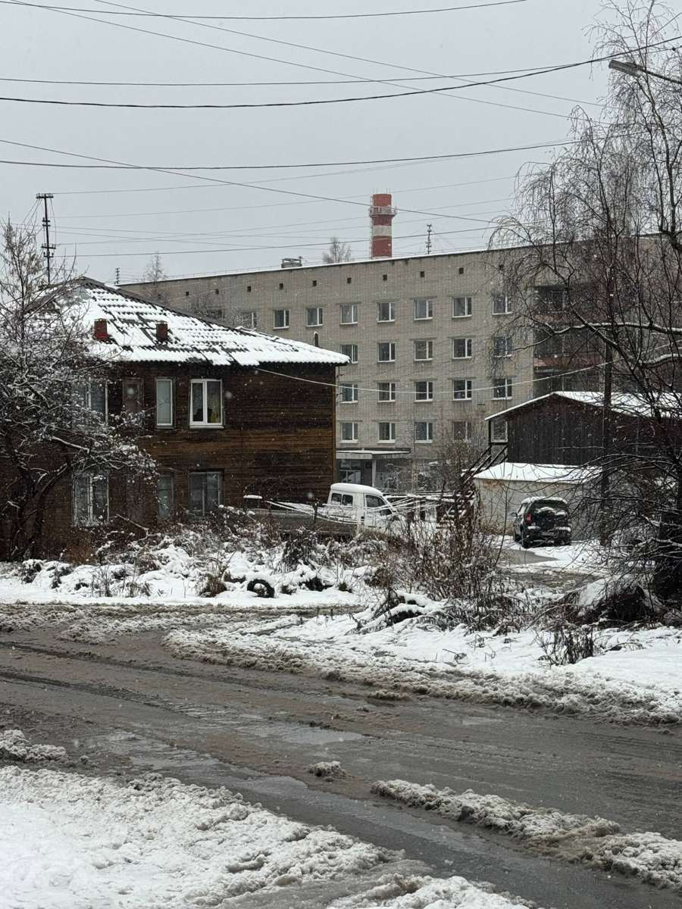
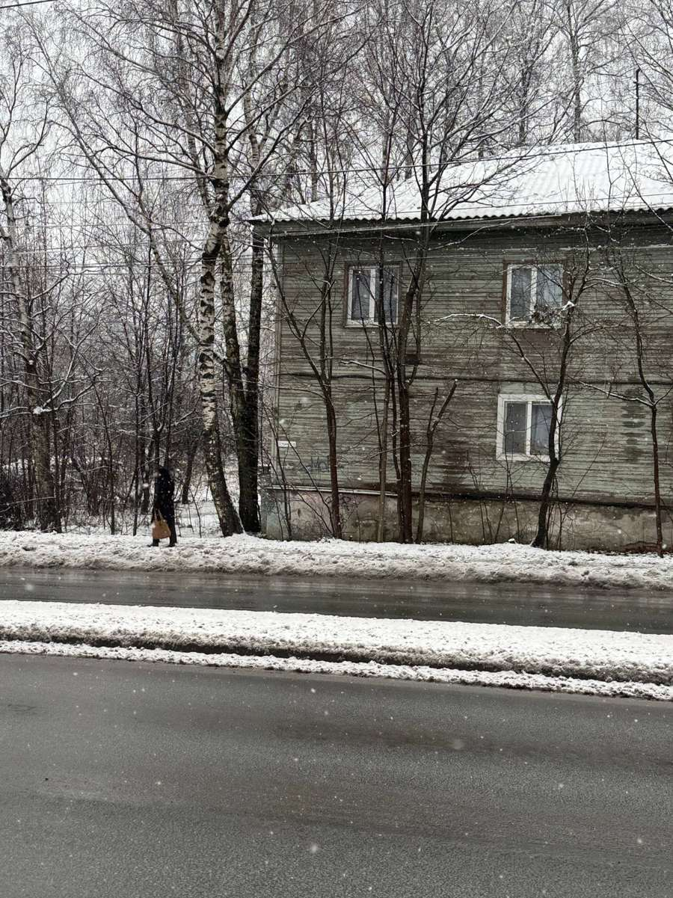

title: Карелия между открыткой и повседневностью
seo_title: Карелия между открыткой и повседневностью: дороги, жильё и медицина
date: 2026-11-26 09:52
updated: 2026-11-26 09:52
rubric: politika
description: Туристы едут в Карелию за озёрами и лесами. Жители сталкиваются с оттоком населения, аварийным жильём, нехваткой врачей и закрытой границей с Финляндией.
image: karelia-3.jpg
image_caption: Петрозаводск, 23 ноября 2026 года. Набережная Онежского озера. Фото автора.
image_credit: Фото автора
image_license: Авторское фото
src: Правительство Карелии. Региональная программа повышения рождаемости, редакция от 4 августа 2026 года | https://kodeks.karelia.ru/api/show/465433352
src: Стратегия социально-экономического развития Петрозаводска до 2034 года | https://kodeks.karelia.ru/api/show/408119792
src: Правительство Карелии. Этап расселения аварийного жилья и план на 2026 год, 7 октября 2026 года | https://adm.gov10.ru/news/07-10-2026-glava-karelii-lichno-kontroliruet-novyy-etap-rasseleniya-avariynogo-zhilya-v-respublike/
src: Правительство Карелии / ГАРАНТ. Региональная программа здравоохранения, дефицит медицинских кадров | https://kodeks.karelia.ru/api/show/407863318
src: Обращение сотрудников и пациентов Межрайонной больницы №1 в Костомукше, 2 июня 2026 года | https://mustoi.ru/v-bolnice-kostomukshi-zayavili-o-massovom-uvolnenii-vrachej-i-ugroze-dlya-pacientov/
src: Правительство Карелии. Девять новых автомобилей скорой помощи, 26 октября 2026 года | https://adm.gov10.ru/news/26-10-2026-devyat-novykh-avtomobiley-skoroy-pomoshchi-poluchili-meditsinskie-organizatsii-karelii/
src: Правительство Карелии. Ремонт поликлиники №3 и трудности записи к узким специалистам, 27 октября 2026 года | https://adm.gov10.ru/news/27-10-2026-glava-karelii-artur-parfenchikov-proveril-khod-kapremonta-v-poliklinike-3-v-petrozavodske/
src: Карелиястат. Туризм и средства размещения в Республике Карелия, 28 октября 2026 года | https://10.rosstat.gov.ru/news/document/292794
src: РБК Карелия. Туристы потратили более 5 млрд рублей в Сортавальском округе в 2025 году, 24 марта 2026 года | https://karelia.rbc.ru/karelia/24/03/2026/69c242f59a79474a5501e2ac
src: Правительство Финляндии. Восточная граница остаётся закрытой до дальнейшего уведомления, 4 июня 2026 года | https://valtioneuvosto.fi/en/-/1410869/finland-s-eastern-border-to-remain-closed-until-further-notice-2
src: Правительство Финляндии. Новые ограничения на въезд граждан России, 19 ноября 2026 года | https://valtioneuvosto.fi/en/-/additional-information-on-the-government-resolution-restricting-the-entry-of-russian-citizens-into-finland?languageId=en_US
src: Балтийский регион. Исследование трансграничной туристской мобильности жителей карельского приграничья, 2022 год | https://balticregion.kantiana.ru/jour/5215/38594/
src: Региональная программа Карелии по сокращению потребления алкоголя до 2030 года | https://kodeks.karelia.ru/api/show/407911190
src: Минздрав Карелии. Динамика расчётного потребления алкоголя, 18 июня 2026 года | https://gubdaily.ru/news/nikakix-rekordov-v-minzdrave-rasskazali-skolko-pyut-v-karelii/
src: РИА Новости. Рейтинг регионов по преступности за 2025 год, 19 января 2026 года | https://riarating.ru/infografika/20260119/630291420.html
src: Коммерсантъ. Карелия вошла в тройку регионов с высоким уровнем преступности в первом полугодии 2026 года, 16 июля 2026 года | https://www.kommersant.ru/doc/8816058
src: КарелИнформ. Число зарегистрированных преступлений в Карелии снизилось на 15,4%, 19 февраля 2026 года | https://karelinform.ru/news/2026-02-19/v-zaksobranii-karelii-obsudili-itogi-raboty-mvd-respubliki-v-proshlom-godu-5553312
src: РБК Карелия. Конфискация 10,6 млн рублей у Владимира Лабинова, 27 октября 2026 года | https://karelia.rbc.ru/karelia/27/10/2026/6ae05b0b3a6b753ff0e337f9
src: РБК Карелия. Приговор Алексею Кайдалову, 21 ноября 2022 года | https://karelia.rbc.ru/karelia/21/11/2022/637b37129a794784736eae85
src: Прокуратура Карелии. Дело Владимира Любарского направлено в суд, 4 февраля 2026 года | https://epp.genproc.gov.ru/ru/gprf/mass-media/news/regional/e8373336/
src: Noctu. Показания свидетеля по делу Владимира Любарского, 23 ноября 2026 года | https://noctu.ru/news/mishiev-v-petrozavodskom-sude-dal-pokazaniya-2026-11-23
src: Карелия.News. Дело Дмитрия Родионова: заочный арест и межгосударственный розыск, 2026 год | https://karelia.news/news/10239358/advokat-ya-ne-znayu-gde-rodionov/
src: Официальная биография Артура Парфенчикова, Правительство Карелии | https://gov10.ru/power/executive/leader/
src: Рабочая встреча Владимира Путина с Артуром Парфенчиковым, 27 мая 2022 года | https://karelia.news/news/10060248/vladimir-putin-podderzhal-artura-parfenchikova-v-namerenii-prodolzhit-rabotu-v-kachestve-glavy-karelii/
src: Минэкономразвития Карелии. Инвестиции в основной капитал в 2025 году, 16 апреля 2026 года | https://economy.gov10.ru/news/16-04-2026-artur-parfenchikov-kareliya-sokhranila-vysokiy-uroven-investitsionnoy-aktivnosti-i-ostaetsya-privlek/
src: Газета «Карелия». В 2025 году отремонтировано 172 км региональных дорог и 7 мостов, 13 апреля 2026 года | https://gazeta-karelia.ru/news/2026/04/v-karelii-v-2025-godu-otremontirovano-172-kilometra-regionalnyh-dorog-i-7-avarijnyh-mostov-na-nih/
src: Правительство Карелии. Снижение аварий в сфере ЖКХ на 30%, 17 апреля 2026 года | https://adm.gov10.ru/news/17-04-2026-artur-parfenchikov-blagodarya-modernizatsii-kommunalnogo-khozyaystva-kolichestvo-avariy-v-sfere-zhkkh/
src: Коммерсантъ. Бастрыкин раскритиковал работу карельского следственного управления, 13 мая 2026 года | https://www.kommersant.ru/doc/8654853
src: Новости Карелии. Поручение Бастрыкина по обращению жителей аварийного дома на улице Коммунистов, 23 сентября 2026 года | https://news-karelia.ru/incident/2026/09/23/32422.html
src: Петрозаводск ГОВОРИТ. Ежегодный отчёт главы Карелии о работе правительства за 2025 год, 20 апреля 2026 года | https://ptzgovorit.ru/news/parfenchikov-kareliya-nabrala-horoshiy-temp-i-dvizhetsya-vpered
---

Карелия встречает туриста озёрами, островами и северной тишиной. Для тех, кто живёт здесь постоянно, регион измеряется иначе: дорогой до дома, состоянием жилья, очередью к врачу и расстоянием до ближайшей больницы.

На снимке Кижей, который часто сопровождает разговоры о республике, — вода и теплоходы у причала. На улицах Петрозаводска, которые мы сняли 23 ноября, другой пейзаж: мокрый асфальт, снежная каша у обочины и деревянные дома. Это не две разные Карелии, а две стороны одного региона. Туристический образ существует рядом с повседневностью, которую не увидишь за выходные.

Петрозаводск — не просто крупнейший город республики. Здесь сосредоточено около 45% её населения: на 1 января 2025 года в городском округе жили 234 577 человек, во всей Карелии — 518 950. Для жителей районов столица остаётся местом, где находятся многие специализированные учреждения, административные службы и рабочие места.

Городская стратегия, утверждённая в декабре 2025 года, фиксирует: примерно 22% протяжённости местных автомобильных дорог не отвечают нормативным требованиям. На уровне всей республики региональные власти сообщили о ремонте 172 километров региональных дорог и семи мостов в 2025 году. Это другая категория дорожной сети: такие работы не отменяют проблем муниципальных улиц. Состояние одной улицы не описывает весь город, но официальный документ подтверждает, что проблема не сводится к впечатлению случайного прохожего.

<figure class="inphoto"><figcaption>Петрозаводск, 23 ноября 2026 года. Улица с деревянной застройкой. Фото автора.</figcaption></figure>

## Старый жилой фонд и очередь на переселение

Деревянная двухэтажная застройка остаётся частью городской среды. По внешнему виду отдельного дома нельзя определить, признан ли он аварийным. Но проблема старого жилья в Карелии давно вышла за пределы отдельных адресов. В октябре 2026 года региональные власти сообщали, что в республике необходимо расселить более 5,3 тысячи аварийных домов общей площадью около 1,2 миллиона квадратных метров. До конца года правительство планировало расселить не менее тысячи квартир: около 400 через компенсации и покупку жилья на вторичном рынке, ещё 624 семьи должны были переехать в пять новостроек. Это план, а не итоговая статистика; его исполнение можно будет оценить после завершения года.

Для человека, который живёт в таком доме, статистика означает ожидание конкретного срока, нового адреса и ответа на простой вопрос: сколько ещё зим придётся провести в старом жилье. В мае 2026 года председатель Следственного комитета Александр Бастрыкин раскритиковал работу регионального следственного управления из-за затягивания расследования дела о нарушении прав жителей аварийных домов. В сентябре он вновь поручил представить доклад по обращению жителей дома на улице Коммунистов в Петрозаводске, где, по их словам, протекала кровля, была сырость и промерзали коммуникации.

<figure class="inphoto"><figcaption>Петрозаводск, 23 ноября 2026 года. Деревянная жилая застройка. Фото автора.</figcaption></figure>

## Республика, которая становится меньше

С 2015 по 2024 год население Карелии сократилось примерно на 77,2 тысячи человек, или на 12,9%. Региональная программа связывает это с естественной убылью и миграционным оттоком. На 1 января 2025 года в республике жили 518 950 человек; около 80% населения приходилось на города.

Петрозаводск удерживает почти половину жителей региона, но и столица не растёт. За пределами города население распределено по небольшим городам и большим расстояниям. Плотность населения Карелии — около 2,9 человека на квадратный километр. В официальных документах по организации экстренной медицинской помощи расстояние от отдельных населённых пунктов до административного центра достигает 550 километров.

Есть и положительная демографическая динамика: региональные власти сообщали, что суммарный коэффициент рождаемости в августе 2026 года вырос до 1,463 против 1,443 годом ранее. Но этот показатель не отменяет уже накопленного сокращения населения и не учитывает миграционный отток.

## Медицина: дефицит не ограничивается столицей

В региональной программе здравоохранения указан дефицит по итогам 2025 года: 127 врачей и 276 работников со средним медицинским образованием. Среди наиболее востребованных специалистов — участковые терапевты и педиатры, врачи общей практики, онкологи и оториноларингологи.

В июне 2026 года сотрудники и пациенты Межрайонной больницы №1 в Костомукше публично заявили об уходе 12 специалистов за несколько месяцев. В обращении перечислялись гинекологи, хирурги, травматологи и врачи ультразвуковой диагностики. Авторы обращения говорили об угрозе доступности медицинской помощи. Это содержание публичного заявления, а не независимый аудит кадров больницы.

Региональные власти сообщали и о мерах по обновлению инфраструктуры. В октябре 2026 года медицинским организациям Карелии передали девять новых автомобилей скорой помощи; в Петрозаводске глава республики проверял капитальный ремонт поликлиники №3. Новые машины и отремонтированные помещения важны, но сами по себе они не отвечают на вопрос, насколько быстро житель отдалённого района может попасть к нужному специалисту. В октябрьском сообщении о ремонте поликлиники №3 региональные власти сами признали, что пациентам по-прежнему трудно записаться к отдельным узким специалистам. Это уточняет характер проблемы: обновление зданий и оборудования не заменяет врачей.

## Костомукша: промышленность не решает всё

Костомукша выделяется на фоне многих районных городов промышленной занятостью. Здесь работает «Карельский окатыш», а добыча и переработка железной руды формируют основу местной экономики. Но крупное предприятие не может заменить больницу, общественный транспорт, коммунальные сети и жильё.

Этот разрыв особенно заметен там, где работа связана с одним доминирующим работодателем. Зарплата может быть выше, чем в соседних населённых пунктах, но качество повседневной жизни зависит не только от места работы. Для семьи имеют значение доступность врача, состояние школы, дороги и возможность решить бытовые вопросы без поездки в другой город.

## Туризм растёт. Но рост неравномерен

Туризм остаётся одной из отраслей, где Карелия показывает рост. По данным Карелиястата, в 2025 году гостиницами, базами отдыха, кемпингами, глэмпингами и другими коллективными средствами размещения воспользовались 732,7 тысячи человек. За пять лет число размещённых гостей выросло в 1,3 раза. Больше всего гостей остановились в Петрозаводске — 232,3 тысячи, затем следуют Сортавальский округ — 160,8 тысячи и Кондопожский район — 63,1 тысячи.

Оперативная оценка числа туристических поездок за 2025 год составила около 1,4 миллиона, на 35% больше предыдущего года. Это не то же самое, что число гостей в гостиницах: поездки включают и тех, кто не пользовался коллективными средствами размещения. В Сортавальском округе туристы, по оценке местных властей и бизнеса, потратили за год более 5 миллиардов рублей.

Туризм приносит работу гостиницам, кафе, перевозчикам, экскурсоводам и малому бизнесу. Кижи, Ладога, Сортавала и Беломорские петроглифы формируют узнаваемый образ региона. Но туристическая Карелия и Карелия повседневная — не одно и то же. Гость приезжает на несколько дней, местный житель каждый день пользуется дорогой, поликлиникой, школой и коммунальными сетями. Рост числа поездок сам по себе не показывает, стали ли эти услуги лучше для тех, кто здесь живёт.

## Граница с Финляндией закрыта. Приграничье должно перестроиться

Сухопутные пункты пропуска на границе России и Финляндии закрыты с 15 декабря 2023 года. 4 июня 2026 года правительство Финляндии продлило ограничения на неопределённый срок. Для Карелии это означает разрыв привычных связей приграничных районов: поездок, покупок, туризма и повседневных контактов через границу.

До пандемии поездки в Финляндию были частью обычной жизни для жителей ряда приграничных территорий. Исследование, опубликованное журналом «Балтийский регион» в 2022 году, показывало, что примерно каждый второй опрошенный житель Костомукшского округа и Сортавальского района посещал Финляндию почти ежемесячно. Авторы также отмечали влияние ограничений трансграничного движения на финансовое благополучие части семей и занятость в обслуживании финских туристов. Это исследование описывает пандемийный период, а не измеряет потери после закрытия границы в декабре 2023 года.

В ноябре 2026 года ограничения получили ещё одно измерение. Финляндия стала применять решение, принятое 12 ноября и вступившее в действие 16 ноября: оно касается краткосрочного въезда граждан России для несущественных целей, в том числе краткосрочной работы по шенгенской визе. Такая работа допускается только в случаях, которые финские власти считают необходимыми для национальных интересов. Ограничения применяются и к тем, кто въезжает по визе, выданной другой страной Шенгенской зоны.

Это не полный запрет на въезд для всех граждан России: решение не затрагивает пребывание по виду на жительство, выданному другой страной ЕС или Шенгенской зоны, и право просить международную защиту. Но для приграничных жителей и тех, чья работа связана с поездками, возможности обычных контактов становятся уже.

Закрытие границы произошло не в вакууме. Ему предшествовали пандемия, санкции и общее сворачивание экономических контактов. Было бы неверно приписывать все трудности приграничных районов одному решению Хельсинки. Но столь же неверно считать, что прекращение регулярного пассажирского сообщения ничего не изменило для жителей и местного бизнеса.

В этих условиях от региональных и муниципальных властей требуется не объяснение всех проблем геополитикой, а практический ответ на неё: новые рынки для местного бизнеса, туристические маршруты, транспортная связанность, поддержка малого предпринимательства и круглогодичная занятость. Геополитическая ситуация задаёт ограничения, но не отменяет региональную ответственность.

## Алкоголь: высокий показатель и снижение

В региональной программе сокращения потребления алкоголя указано, что в 2024 году на одного жителя Карелии приходилось 13,96 литра чистого этанола. В июне 2026 года Минздрав республики сообщил о снижении расчётного потребления: с 13,7 литра на человека в январе 2025 года до 11,7 литра в декабре. За май 2026 года ведомство приводило показатель 11,4 литра. Эти значения относятся к разным периодам и методикам, поэтому их нельзя напрямую сравнивать с базовым показателем региональной программы. Но динамика, которую приводит Минздрав, указывает на снижение.

## Преступность: снижение не изменило общую картину

По данным МВД, в 2025 году в Карелии зарегистрировали 9 511 преступлений против 11 237 годом ранее. Снижение составило 15,4%. Но в пересчёте на численность населения республика осталась среди регионов с самым высоким уровнем зарегистрированной преступности: около 183 преступлений на 10 тысяч жителей, по рейтингу РИА Новости на основе данных МВД.

В первом полугодии 2026 года Карелия вновь оказалась в тройке регионов с наиболее высоким уровнем: 79,3 преступления на 10 тысяч жителей против примерно 54 в среднем по стране. Эти показатели описывают зарегистрированные преступления, а не вероятность стать жертвой конкретного преступления для каждого жителя. Но они показывают, что снижение общего числа эпизодов пока не изменило положение региона в общероссийском сравнении.

## Бывшие чиновники: приговоры и обвинения

В последние годы несколько бывших высокопоставленных чиновников Карелии стали фигурантами уголовных дел. Их процессуальные статусы различаются, поэтому важно отделять вступившие в силу приговоры от обвинений, которые ещё рассматриваются судом.

Бывший министр сельского и рыбного хозяйства Владимир Лабинов в феврале 2025 года был приговорён к 15 годам колонии строгого режима и штрафу 106,4 миллиона рублей. В октябре 2026 года Верховный суд Карелии оставил в силе решение о конфискации у него более 10,6 миллиона рублей, полученных в качестве взятки.

Бывший министр транспорта Алексей Кайдалов в ноябре 2022 года получил 15 лет колонии строгого режима и штраф 40 миллионов рублей по делу о взятках, связанных с реконструкцией аэропорта Петрозаводска.

В отношении бывшего главы Петрозаводска и экс-заместителя главы республики Владимира Любарского прокуратура в феврале 2026 года сообщила об утверждении обвинительного заключения и направлении дела в суд. Его обвиняют в получении взяток на сумму свыше 33 миллионов рублей. 23 ноября 2026 года, по сообщению издания Noctu, в суде выступил учредитель компании «Диетгрупп» Станислав Мишиев, который дал показания о передаче денег в 2017–2022 годах. Это показания свидетеля в ходе процесса, а не установленный приговором факт. Любарский вину не признаёт.

Бывший вице-премьер Карелии Дмитрий Родионов обвиняется в мошенничестве в особо крупном размере. В марте 2026 года Петрозаводский городской суд заочно арестовал его; позднее он был объявлен в межгосударственный розыск. В июне Верховный суд Карелии оставил решение о заочном аресте без изменения. Обвинение не означает установленной судом виновности.

Эти дела относятся к разным эпизодам и не доказывают связи между собой. Но они стали частью общественного разговора о том, как распоряжались ресурсами республики и кто отвечал за решения, от которых зависела жизнь региона.

## Парфенчиков: возвращение в Карелию после федеральной карьеры

Артур Парфенчиков — уроженец Петрозаводска. Он родился 29 ноября 1964 года, окончил юридический факультет Ленинградского государственного университета в 1987-м и начал карьеру в прокуратуре Карелии. В 2006 году возглавил управление Федеральной службы судебных приставов по Санкт-Петербургу, а в 2008-м был назначен директором ФССП России.

В феврале 2017 года Владимир Путин назначил Парфенчикова временно исполняющим обязанности главы Карелии. В сентябре того же года он был избран главой республики, а в 2022 году переизбран.

На отдельной рабочей встрече с президентом 27 мая 2022 года Парфенчиков докладывал о положении дел в регионе, просил продлить льготные тарифы на электроэнергию для предприятий и поддержать создание федерального учреждения «Аэропорты Карелии». Обсуждалось и расселение аварийного жилья.

Есть результаты, которые региональное правительство относит к достижениям периода его руководства. По итогам 2025 года объём инвестиций в основной капитал, по данным Минэкономразвития Карелии, превысил 107 миллиардов рублей; 76% вложений ведомство отнесло к частному капиталу. В 2025 году в республике отремонтировали 172 километра региональных дорог и семь аварийных мостов. Правительство также сообщало о снижении числа аварий и инцидентов в коммунальном хозяйстве на 30%.

Эти показатели опубликованы региональными ведомствами. Их значение для жителей определяется не только объёмом вложений и количеством отремонтированных километров, но и тем, как изменилась повседневная жизнь. В мае 2026 года председатель Следственного комитета публично обратил внимание на волокиту в расследовании дела о нарушении прав жителей аварийных домов в Петрозаводске. Это не свидетельствует о личной ответственности главы республики за конкретное уголовное дело, но показывает, что проблема расселения остаётся предметом федерального внимания.

В апреле 2026 года Парфенчиков представил Законодательному собранию ежегодный отчёт о работе правительства за 2025 год. Депутаты задавали вопросы о школах, подготовке кадров, муниципалитетах, аварийном жилье, ЖКХ, тарифах и инвестициях. Отчёт был принят к сведению большинством голосов. Оценка работы региональной власти в итоге складывается из двух наборов показателей: привлечённых ресурсов и реализованных проектов — и проблем, которые за годы руководства так и не исчезли.

## Две Карелии

Карелия остаётся регионом с сильными природными и экономическими преимуществами. Озёра, леса, культурное наследие и туристический поток дают ей возможности для роста. Промышленность сохраняет рабочие места, а инвестиционные проекты меняют отдельные города.

Но для постоянного жителя республика измеряется не количеством теплоходов у Кижей и не числом гостиничных гостей. Она измеряется дорогой до дома, сроком переселения из аварийного жилья, возможностью попасть к врачу и тем, сколько времени занимает путь до нужной услуги.

Туристическая Карелия не выдумана. Повседневная Карелия тоже. Между ними остаётся дистанция, которую нельзя сократить одним ростом туризма или инвестиционной статистикой. Её сокращение зависит от того, превращаются ли ресурсы региона в доступные услуги, нормальное жильё и устойчивую жизнь за пределами туристических маршрутов.
